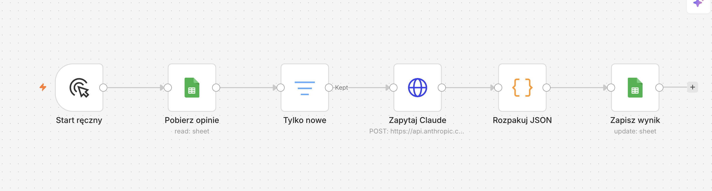

# Asystent opinii

Automat do analizy opinii gości hotelowych. Zbiera opinie, klasyfikuje je przy pomocy Claude API (sentyment, kategoria), przygotowuje propozycję odpowiedzi, a wyniki podsumowuje i pokazuje na prostej stronie.

**Strona z wynikami:** https://kacperkurowski02.github.io/Asystent-opinii/

> ⚠️ **Wszystkie dane w projekcie są fikcyjne.** Opinie, imiona gości i daty zostały wymyślone na potrzeby demonstracji.

## Jak to działa

```
Google Sheets  →  n8n  →  Claude API  →  Google Sheets  →  SQL (SQLite)  →  strona WWW
 (nowe opinie)   (workflow)  (analiza)     (wyniki)        (analiza.py)    (index.html)
```

1. **Google Sheets**: arkusz z nowymi opiniami gości.
2. **n8n**: workflow pobiera kolejne opinie z arkusza i wysyła je do modelu.
3. **Claude API**: dla każdej opinii określa sentyment (pozytywny / neutralny / negatywny), kategorię (np. obsługa, pokój, gastronomia, ceny, SPA) i pisze propozycję odpowiedzi.
4. **Google Sheets**: n8n zapisuje wyniki z powrotem do arkusza (kolumny `sentyment`, `kategoria`, `odpowiedz`, `status`).
5. **SQL**: w wersji 1 arkusz wyeksportowany do `opinie.csv` trafia do bazy SQLite (`opinie.db`), gdzie `analiza.py` liczy zestawienia.
6. **Strona**: `index.html` pokazuje trzy tabele: sentyment, kategorie i opinie negatywne. W wersji 2 dane pobiera prosto z arkusza.

### Workflow w n8n



| Węzeł              | Co robi                                                                                 |
|--------------------|-----------------------------------------------------------------------------------------|
| **Start ręczny**   | Uruchamia workflow przyciskiem w n8n.                                                   |
| **Pobierz opinie** | Czyta wiersze z arkusza Google Sheets `opinie`.                                         |
| **Tylko nowe**     | Przepuszcza tylko wiersze z pustym `status`, czyli jeszcze nieprzeanalizowane.          |
| **Zapytaj Claude** | Wysyła opinię do Claude API; model zwraca JSON z sentymentem, kategorią i odpowiedzią. |
| **Rozpakuj JSON**  | Wyciąga JSON z odpowiedzi modelu i ustawia `status` na `gotowe`.                        |
| **Zapisz wynik**   | Aktualizuje wiersz w arkuszu (dopasowanie po kolumnie `id`).                            |

Workflow można zaimportować do n8n z pliku [`workflow-n8n.json`](workflow-n8n.json). Po imporcie trzeba podpiąć własne dane logowania: konto Google Sheets oraz nagłówek `x-api-key` z kluczem Claude API.

## Wersja 2: strona czyta arkusz na żywo

Strona (`index.html`) nie korzysta już z `data.json`. Zamiast tego:

- pobiera arkusz jako CSV przez `fetch` z adresu Google Sheets (`.../gviz/tq?tqx=out:csv&sheet=opinie`), z parametrem czasu w adresie, żeby ominąć pamięć podręczną,
- pomija wiersze z pustym `status` (opinie jeszcze nieprzeanalizowane przez n8n),
- przelicza w JavaScripcie te same trzy zestawienia co zapytania SQL z wersji 1,
- odświeża dane automatycznie co 60 sekund i pokazuje godzinę ostatniej aktualizacji.

Dzięki temu nowa opinia przeanalizowana przez n8n pojawia się na stronie najpóźniej po minucie, bez uruchamiania skryptów i bez nowego commita. Arkusz musi być udostępniony do odczytu każdemu, kto ma link.

## Wersja 1: analiza SQL (`analiza.py`)

Pierwsza wersja liczy zestawienia w SQL na eksporcie arkusza. Wymagany jest tylko Python 3, bez dodatkowych pakietów.

```bash
python3 analiza.py
```

Skrypt:

1. tworzy od nowa bazę `opinie.db` i wczytuje do niej `opinie.csv`,
2. wykonuje trzy zapytania SQL: opinie wg sentymentu, kategorie wg liczby negatywnych opinii, lista opinii negatywnych (od najnowszej),
3. wypisuje wyniki w terminalu i zapisuje je do `data.json`.

## Technologie

- Google Sheets
- n8n (automatyzacja workflow)
- Claude API (Anthropic)
- Python 3 (biblioteka standardowa: `csv`, `sqlite3`, `json`)
- SQLite / SQL
- HTML, CSS, JavaScript (bez frameworków i bibliotek zewnętrznych)
- GitHub Pages

## Struktura plików

| Plik                | Opis                                                          |
|---------------------|---------------------------------------------------------------|
| `index.html`        | Strona: pobiera arkusz na żywo i pokazuje trzy tabele (v2)    |
| `n8n-workflow.png`  | Zrzut ekranu workflow w n8n                                   |
| `workflow-n8n.json` | Eksport workflow do zaimportowania w n8n                      |
| `opinie.csv`        | Opinie wyeksportowane z arkusza (z wynikami analizy Claude)   |
| `analiza.py`        | Wczytuje CSV do SQLite, uruchamia zapytania, zapisuje JSON (v1) |
| `data.json`         | Wyniki zapytań SQL z wersji 1                                 |

## Podgląd strony lokalnie

Najprościej przez lokalny serwer:

```bash
python3 -m http.server
```

i otwórz http://localhost:8000.
